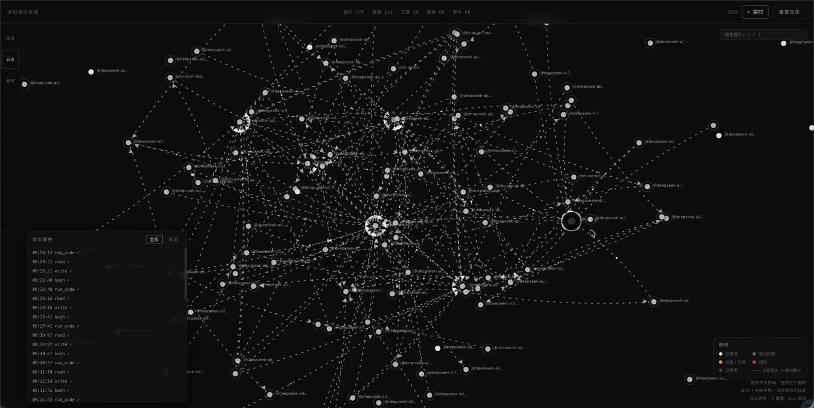
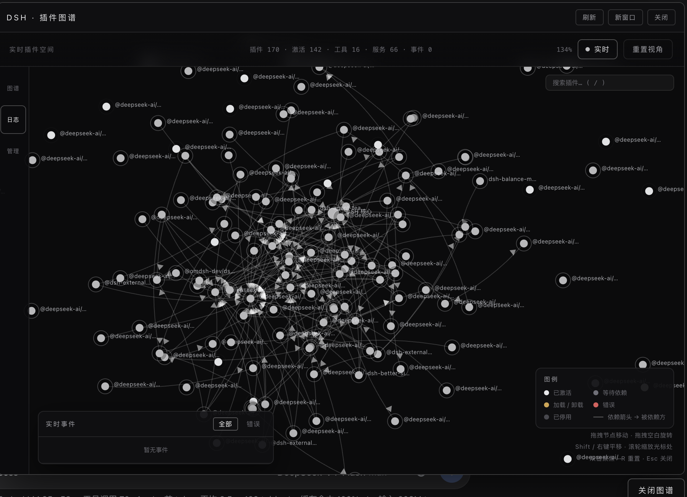
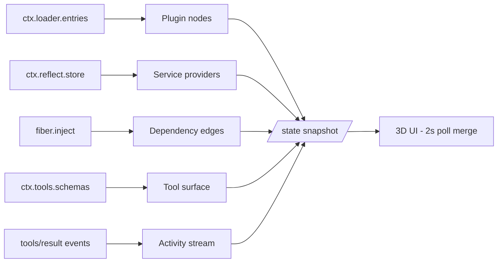

# dsh-3d-plugin-graph

> A live 3D visualization of the DSH plugin ecosystem. Every node, edge and state you see is the real Cordis runtime — nothing is mocked.

[简体中文 README](README.zh-CN.md)

   

[](docs/demo.mp4)

▶ [Open the demo video in the browser](docs/demo.mp4)



## What is it?

[DSH](https://github.com/deepseek-ai/) (DeepSeek Harness) is itself an ecosystem of **170+ Cordis plugins**. This plugin opens a window into that ecosystem: it reads the running Cordis runtime and renders the live plugin topology as an interactive 3D graph you can orbit, zoom, drag and operate.

- **Nodes** are real runtime plugins (loader entries / registry fibers).
- **Edges** are real dependency relations (service providers from the reflect store × inject declarations on each fiber; the arrow points at the dependency).
- **States** are the real fiber state machine (active / pending / loading / error / disabled / unloading), refreshed every 2 s — drag a node around and watch its neighbours follow; unplug a plugin from the graph itself and see the whole neighbourhood react.
- **Activity** streams from real `tools/result` events — when a tool runs, white light motes travel along the affected edges in real time.

## Features

### Real runtime data
- Nodes / edges / services / tool surface all come from the live runtime (`ctx.loader.entries()`, `ctx.reflect.store`, `ctx.tools.schemas()`, `tools/result` events); the UI merges state polls without ever moving your dragged nodes.
- Graceful degradation: with no reachable source it falls back to an offline demo so the UI is never a blank page.

### Interaction
- **Orbit / pan / zoom**: drag empty space to orbit (bounded pitch), Shift / right-drag to pan, wheel to zoom **anchored at the node under the cursor** (it stays glued to the cursor), double-click a node to focus, `R` to reset, `Esc` to close.
- **Node dragging with physics**: nodes are solid bodies — dragging one pushes others out of the way (velocity-impulse collision), and spring edges pull connected nodes along. Release and the graph settles back into balance.
- **Label LOD**: far away only the core label shows; labels fade in as you zoom; occluded labels hide automatically (8px type, occlusion-aware).

### Operations & safety
- **Unplug requires double confirmation**: arming it shows the cascade impact count, the list of affected dependents, and a dedicated warning when the plugin is part of a dependency cycle — because unplugging a mutual dependency can destabilise the harness itself.
- **No auto re-insertion**: unplug is a real `entry.update({disabled:true})`; nothing silently re-inserts a plugin later.
- **Server-side guards**: core infrastructure (loader / include / isolate), the graph plugin itself, and any operation whose cascade would hit the graph are refused server-side, not just hidden in the UI.
- **Re-plug is one click** (re-enabling is safe), with live state flip on the next poll.

### Activity & status
- Live tool-execution log (all / errors only) with connection-state pill.
- Runtime flow effects: white motes on active edges, red motes for failed calls; pulse animation when a plugin's state changes.

### UI / UX / performance
- Single-file UI (`assets/index.html`), zero external dependencies, no CDN, no build step.
- 170-node synthetic load (state churn + event stream + drag): **mean frame gap ≈ 17 ms** in the automated perf test — no long hitches.
- Accessibility: `prefers-reduced-motion` support, `focus-visible` outlines, `aria-live` announcements, `color-scheme: dark`.
- Dark, restrained visual language: white node surfaces, state-only accent colours, deep background.

### Security posture
- CSP meta tag (`default-src 'self'`), `X-Content-Type-Options: nosniff`, `esc()` on every server-originated string that touches `innerHTML`.
- Adversarial test suite: XSS payloads through popup / confirm / panel / search, prototype-pollution keys, malformed state payloads — all asserted inert.

## Installation

Requires a DSH installation with a web profile.

```sh
dsh plugin --profile web add https://github.com/jelly-000/dsh-3d-plugin-graph
```

Then restart the web profile (or let HMR pick it up). For local development you can point `add` at a directory instead of a URL.

## Usage

Once installed, open the DSH web UI — a floating **「插件图谱」** entry appears bottom-right. Or access directly:

| What | URL |
| --- | --- |
| The graph UI | `http://127.0.0.1:3080/plugins/dsh-3d-plugin-graph/` |
| Live state JSON | `http://127.0.0.1:3080/plugins/dsh-3d-plugin-graph/state` |
| Enable / disable a plugin | `POST /plugins/dsh-3d-plugin-graph/action` with `{"action":"plug"|"unplug","id":"plugin-xxx"}` |

### Controls

| Input | Action |
| --- | --- |
| Drag empty space | Orbit camera |
| Shift / right drag | Pan |
| Wheel | Zoom, anchored at cursor |
| Drag a node | Move it (physics: collision + springs) |
| Click a node | Select → detail card |
| Double-click a node | Focus it (camera converges) |
| Double-click empty space | Reset view |
| `R` | Reset view |
| `Esc` | Close popup / confirmation |
| Search box (top right) | Fuzzy plugin search, arrows + Enter to focus |

## How it works



Full details in [docs/ARCHITECTURE.md](docs/ARCHITECTURE.md) — key decisions:

- **Drag resolves by id, not by closure**: event handlers look the node up at event time, so 2 s state merges can never leave the pointer holding a ghost object.
- **Drag is isolated from physics**: the dragged node is excluded from collision, springs and drift while held; it stops exactly where you drop it.
- **Real state only**: the graph never invents data; every status, edge and service is read from the runtime.
- **Schema contract**: the `dsh_plugin_graph_status` tool output schema declares every top-level key, so bind failures are impossible.

## Development & testing

```sh
npm install        # no runtime deps; scripts need none either
npm run verify     # offline harness simulation: states, edges, guards, schema, adversarial HTTP
npm run test:ui    # headless Chrome + CDP: real pointer drag / orbit / zoom / unplug flows (77 checks)
npm run test:security  # XSS / prototype-pollution / malformed-data adversarial checks
npm run test:perf  # 170-node synthetic load, asserts mean frame gap < 25 ms
```

All suites run against mock servers and real headless Chrome — no live DSH instance needed.

## Repository layout

```
lib/index.js        Host plugin: /state, /action (guarded), /, /client.js, tool dsh_plugin_graph_status
lib/client.js       Browser client launcher (ModuleLoader protocol), floating entry + panel
assets/index.html   Single-file 3D UI (no external dependencies)
docs/               Architecture notes, screenshot, demo video
scripts/            verify / ui / security / perf test suites
```

## License

[MIT](LICENSE)
