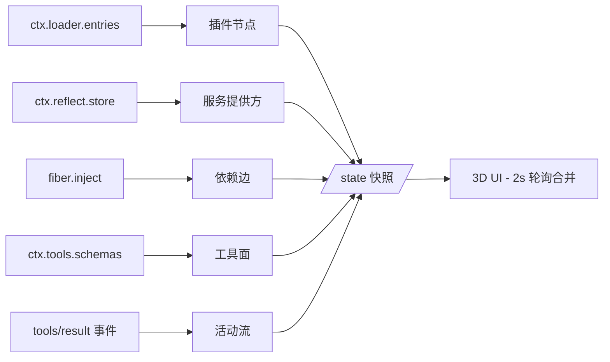

# dsh-3d-plugin-graph

> 把 DSH 的插件生态实时画成一个可交互的 3D 图谱。你看到的每个节点、每条连线、每个状态，都是真实的 Cordis 运行时——没有任何伪造数据。

[English README](README.md)

   


## 这是什么？

DSH（DeepSeek Harness）本身就是由 **170+ 个 Cordis 插件**组成的生态。本插件直接读取运行中的 Cordis 运行时，把真实的插件拓扑渲染成一个可旋转、缩放、拖拽、操作的 3D 图谱：

- **节点** = 运行时中的真实插件（loader entry / registry fiber）
- **连线** = 真实的依赖关系（reflect 服务提供方 × 各 fiber 的注入声明，箭头指向被依赖方）
- **状态** = 真实的 fiber 状态机（已激活 / 等待依赖 / 加载中 / 错误 / 已停用 / 卸载中），每 2 秒刷新——拖动一个节点看邻居被弹簧拉走，直接在图上拔掉一个插件，看整个邻域实时反应
- **动态** = 来自真实 `tools/result` 事件——工具执行时，白色流光沿着受影响的连线实时流动

## 功能特性

### 真实运行时数据
- 节点 / 连线 / 服务 / 工具面全部来自运行时（`ctx.loader.entries()`、`ctx.reflect.store`、`ctx.tools.schemas()`、`tools/result` 事件）；UI 合并轮询快照时**绝不动你正在拖拽的节点**。
- 优雅降级：数据源不可达时回退到离线演示，UI 永不白屏。

### 交互
- **轨道 / 平移 / 缩放**：拖空白旋转（pitch 有界防翻转），Shift / 右键平移，滚轮**锚定光标下节点缩放**（缩放过程中节点牢牢钉在光标下），双击节点聚焦，`R` 复位，`Esc` 关闭。
- **带物理的节点拖拽**：节点是实心体——拖动时会把挡路的节点撞开（速度冲量碰撞），弹簧连线把相连节点一起拉动；松手后图谱自然回稳。
- **标签 LOD**：远处只显示核心标签，放大逐级浮现；被遮挡的标签自动隐藏（8px 字号 + 遮挡感知）。

### 操作与安全
- **拔出需二次确认**：确认区展示级联影响数量、受影响依赖清单；插件处于循环依赖中时给出专门警告——拔掉相互依赖的插件可能让整个 harness 失稳。
- **无自动重插**：拔出是真实的 `entry.update({disabled:true})`，之后不会有什么机制偷偷把插件插回去。
- **服务端二次守卫**：核心基建（loader / include / isolate）、图谱插件自身、以及级联会波及图谱自身的操作，在服务端直接拒绝——不只是 UI 层藏按钮。
- **重新插入一键完成**（启用是安全操作），下一次轮询实时翻转状态。

### 活动与状态
- 实时工具执行日志（全部 / 仅错误），连接状态指示点。
- 运行时流光：执行中的边流动白色光点，出错调用为红色；插件状态变化有脉冲动画。

### UI / 性能
- 单文件 UI（`assets/index.html`），零外部依赖，无 CDN，无构建步骤。
- 170 节点合成负载（状态翻转 + 事件流 + 拖拽）：自动化性能测试中**平均帧间隔 ≈ 17ms**，无长卡顿。
- 无障碍：`prefers-reduced-motion`、`focus-visible` 焦点轮廓、`aria-live` 播报、`color-scheme: dark`。
- 克制的暗色视觉语言：白色节点表面、仅状态色做强调、深邃背景。

### 安全基线
- CSP meta（`default-src 'self'`）、`X-Content-Type-Options: nosniff`、所有进入 `innerHTML` 的服务端字符串一律 `esc()`。
- 对抗式测试：XSS 载荷贯穿弹窗 / 确认区 / 面板 / 搜索、原型污染键、畸形状态载荷——全部断言无害。

## 安装

需要已安装 DSH 并启用 web profile：

```sh
dsh plugin --profile web add https://github.com/jelly-000/dsh-3d-plugin-graph
```

然后重启 web profile（或等 HMR 热载）。本地开发时也可以把 `add` 指向一个目录。

## 使用

安装后打开 DSH Web UI，右下角出现浮动入口「插件图谱」。也可以直接访问：

| 内容 | 地址 |
| --- | --- |
| 图谱界面 | `http://127.0.0.1:3080/plugins/dsh-3d-plugin-graph/` |
| 实时状态 JSON | `http://127.0.0.1:3080/plugins/dsh-3d-plugin-graph/state` |
| 启停插件 | `POST /plugins/dsh-3d-plugin-graph/action`，body 为 `{"action":"plug"|"unplug","id":"plugin-xxx"}` |

### 操作对照

| 输入 | 行为 |
| --- | --- |
| 拖拽空白处 | 旋转视角 |
| Shift / 右键拖动 | 平移 |
| 滚轮 | 光标锚定缩放 |
| 拖拽节点 | 移动它（碰撞 + 弹簧物理） |
| 单击节点 | 选中，打开详情卡 |
| 双击节点 | 聚焦（镜头缓动收敛） |
| 双击空白 | 复位视角 |
| `R` | 复位视角 |
| `Esc` | 关闭弹窗 / 确认 |
| 右上角搜索框 | 模糊搜索插件，方向键 + 回车聚焦 |

## 工作原理



详见 [docs/ARCHITECTURE.md](docs/ARCHITECTURE.md)。关键设计决策：

- **拖拽按 id 解析而非闭包持有**：事件发生时按 `nodeById` 现查节点，2 秒状态合并永远不会让指针指向幽灵对象（历史踩坑根因）。
- **拖拽与物理隔离**：拖拽中的节点排除碰撞、弹簧与漂移；松手即停，不吸附回弹。
- **只画真实状态**：图谱从不发明数据，每个状态 / 边 / 服务都读自运行时。
- **schema 契约**：`dsh_plugin_graph_status` 工具输出 schema 声明全部顶层键，绑定失败不可能发生。

## 开发与测试

```sh
npm install        # 无运行时依赖，测试脚本同样零依赖
npm run verify     # 离线模拟 harness：状态 / 边 / 守卫 / schema / 对抗 HTTP
npm run test:ui    # headless Chrome + CDP：真实指针拖拽 / 轨道 / 缩放 / 拔出全流程（77 项）
npm run test:security  # XSS / 原型污染 / 畸形数据对抗检查
npm run test:perf  # 170 节点合成负载，断言平均帧间隔 < 25ms
```

所有套件都跑在 mock 服务器 + 真实无头 Chrome 上，不需要在线 DSH 实例。

## 仓库结构

```
lib/index.js        宿主插件：/state、/action（带守卫）、/、/client.js、工具 dsh_plugin_graph_status
lib/client.js       浏览器客户端启动器（ModuleLoader 协议），浮动入口 + 面板
assets/index.html   单文件 3D 前端（零外部依赖）
docs/               架构说明、截图、演示视频
scripts/            verify / ui / security / perf 四套测试
```

## License

[MIT](LICENSE)
